# GastroVote

Aplicación de valoración de tapas de la "Ruta de la tapa".

## Tabla de pruebas

Pruebas realizadas sobre la compilación `debug` de la app. Interacción y verificación automatizadas mediante `adb` + inspección de la jerarquía de UI (`uiautomator dump`, equivalente al Layout Inspector para leer los límites/`bounds` de cada nodo).

### Dispositivos utilizados

| Dispositivo | Perfil equivalente | Resolución | Densidad | Marco (skin) |
|---|---|---|---|---|
| Google Pixel 5 | *Small Phone* | 1080×2340 | 440 dpi | Pixel 5 |
| Tablet 10,1" (perfil 1600×2560) | *Medium Tablet* | 1600×2560 | 320 dpi | Nexus 10 |

### Resultados

| # | Condición / caso límite | Resultado | Observaciones |
|---|---|---|---|
| 1 | Dos dispositivos en vertical (móvil pequeño + tablet) | ✅ OK | El banner ocupa todo el ancho y todo el formulario es alcanzable con desplazamiento, también en el móvil pequeño. |
| 2 | Tema claro | ✅ OK | Se muestra correctamente en ambos dispositivos. |
| 3 | Tema oscuro | ✅ OK | Los colores del tema oscuro se aplican en toda la pantalla. |
| 4 | Dispositivo en español | ✅ OK | "LIMPIAR", "Elige un bar", "Publicar reseña", etc. |
| 5 | Dispositivo en inglés | ✅ OK | "CLEAR", "Choose a bar", "Post review", etc. |
| 6 | Tamaño de fuente del sistema al máximo | ✅ OK | Ningún elemento se sale del ancho de pantalla; ver hallazgo del Layout Inspector. |
| 7 | Recorrer todos los bares con ▶ (último → primero) | ✅ OK | Secuencia verificada: 2 → 3 → … → 8 → 1 (envuelve). |
| 8 | Recorrer con ◀ (primero → último) | ✅ OK | Desde el bar 1 se vuelve al bar 8. |
| 9 | Publicar sin estrellas | ✅ OK | Toast "Califica la tapa antes de publicar"; no aparece el resumen de precio. |
| 10 | Precio por tamaño **sin** descuento | ✅ OK | Tapa 3,50 € · Media ración 7,00 € · Ración 10,50 €. |
| 11 | Precio por tamaño **con** descuento de estudiante | ✅ OK | Tapa 3,15 € · Media ración 6,30 € · Ración 9,45 €. |
| 12 | Reseñar dos veces el mismo bar | ✅ OK | El progreso queda en "Ruta: 1 de 8 bares" (no se duplica). |
| 13 | Cancelar el diálogo de Limpiar | ✅ OK | Cierra el diálogo sin borrar los datos introducidos. |
| 14 | Confirmar Limpiar | ✅ OK | Limpia el formulario y muestra el toast "Formulario limpio". |

> Nota sobre los precios: el cálculo es `precio base × tamaño` y, si hay descuento de estudiante, `−10 %`. Para la tapa "Marinera murciana" (3,50 €): Tapa = 3,50 €, Media ración = ×2 = 7,00 €, Ración = ×3 = 10,50 €; con descuento, 3,15 €, 6,30 € y 9,45 € respectivamente.

## Capturas de pantalla

Las capturas incluyen el marco del dispositivo.

### Dispositivos en vertical

| Móvil pequeño (Pixel 5) | Tablet (10,1") |
|---|---|
| 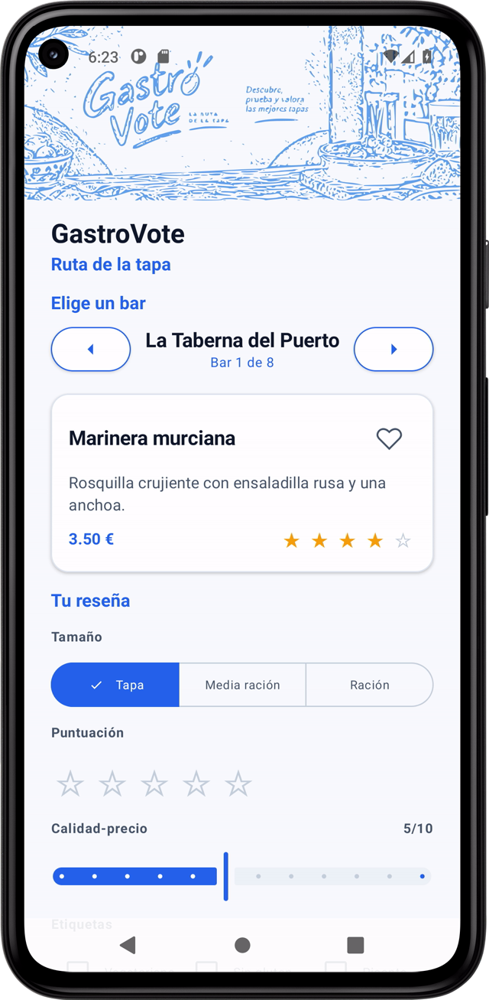 | 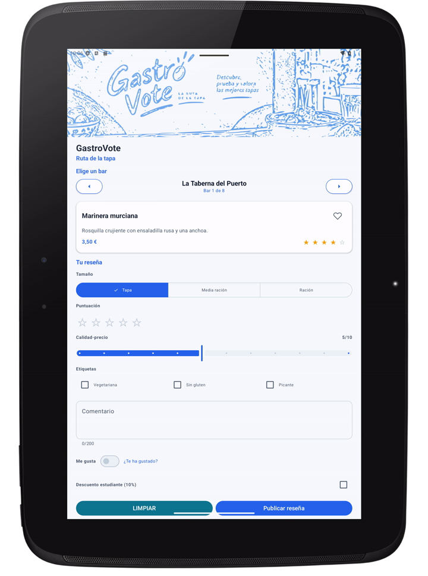 |

### Tema claro y oscuro

| Claro | Oscuro |
|---|---|
|  | 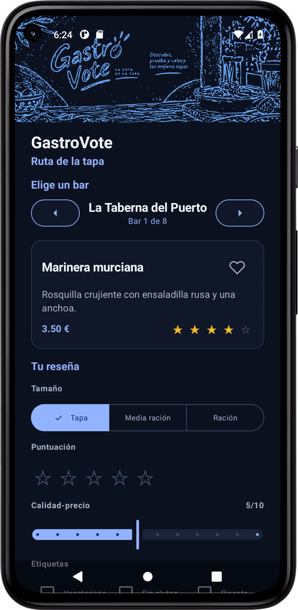 |
|  | 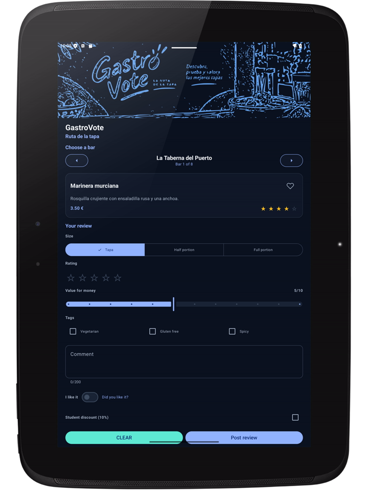 |

### Español e inglés

| Español | Inglés |
|---|---|
|  |  |
|  | 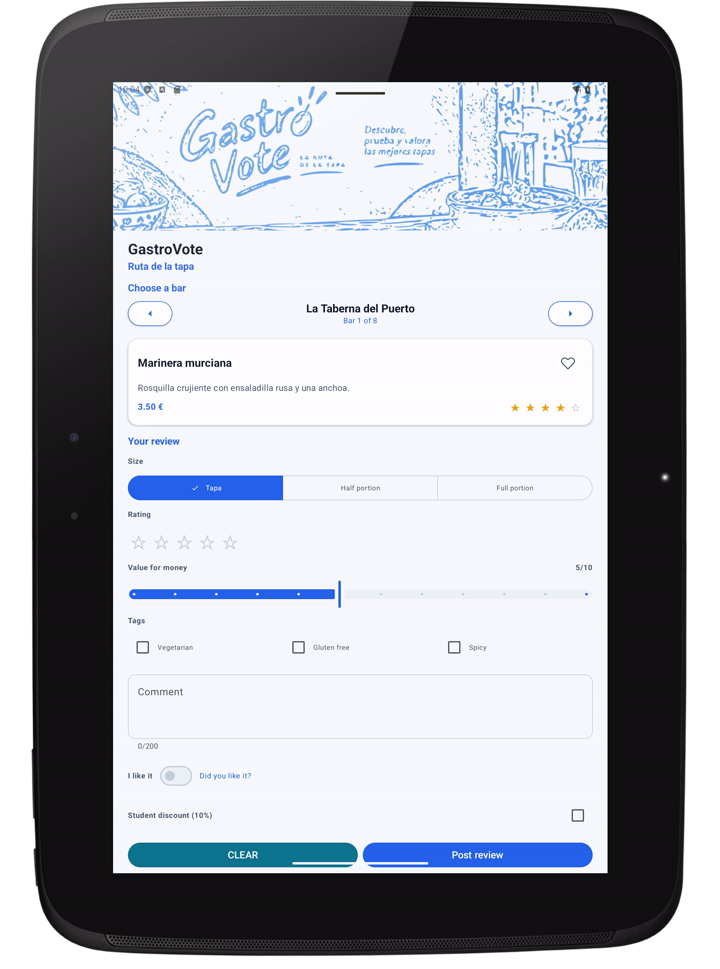 |

### Tamaño de fuente al máximo

| Móvil pequeño | Tablet |
|---|---|
| 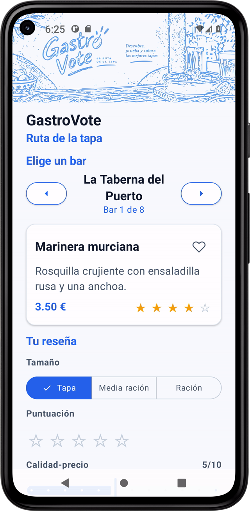 | 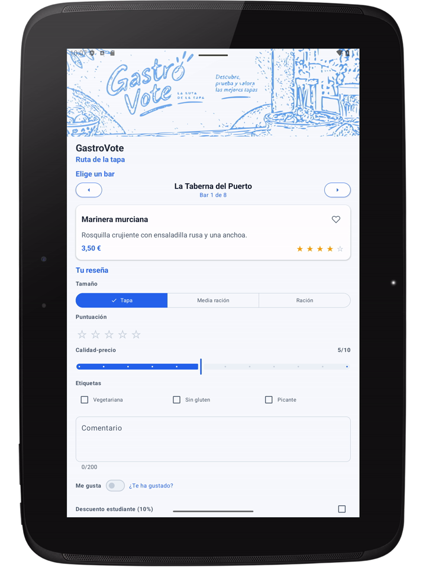 |

### Casos límite

| Caso | Captura |
|---|---|
| Envolver con ▶ (último → primero) | 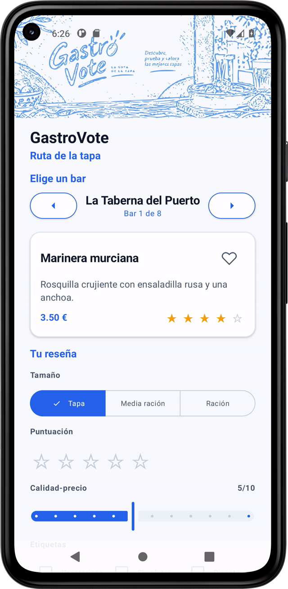 |
| Publicar sin estrellas | 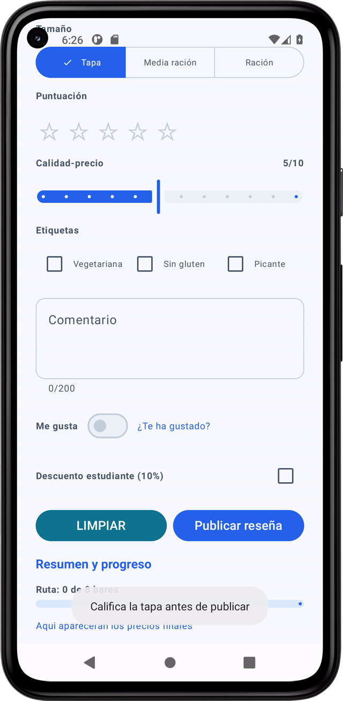 |
| Precio Tapa con descuento (3,15 €) | 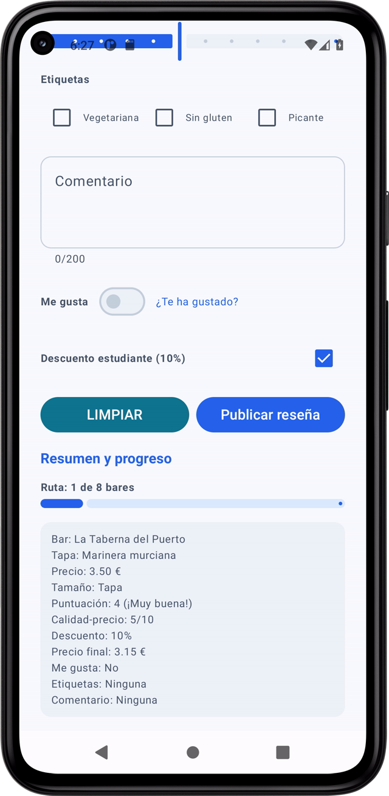 |
| Precio Media ración con descuento (6,30 €) | 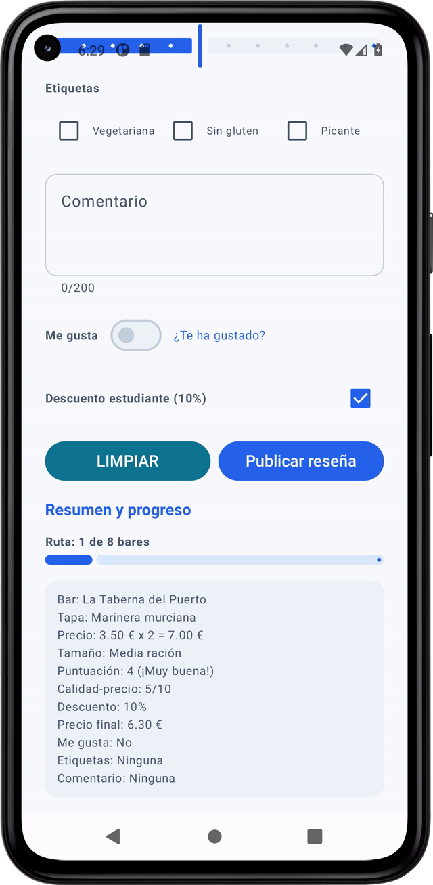 |
| Precio Ración con descuento (9,45 €) |  |
| Reseñar dos veces el mismo bar | 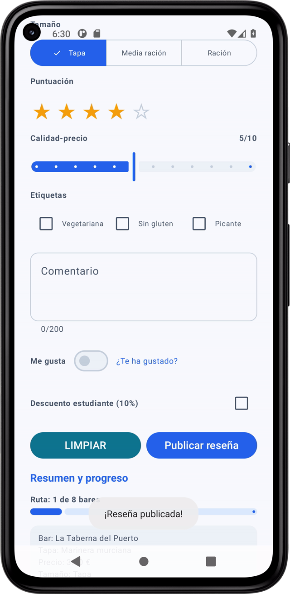 |
| Diálogo de Limpiar | 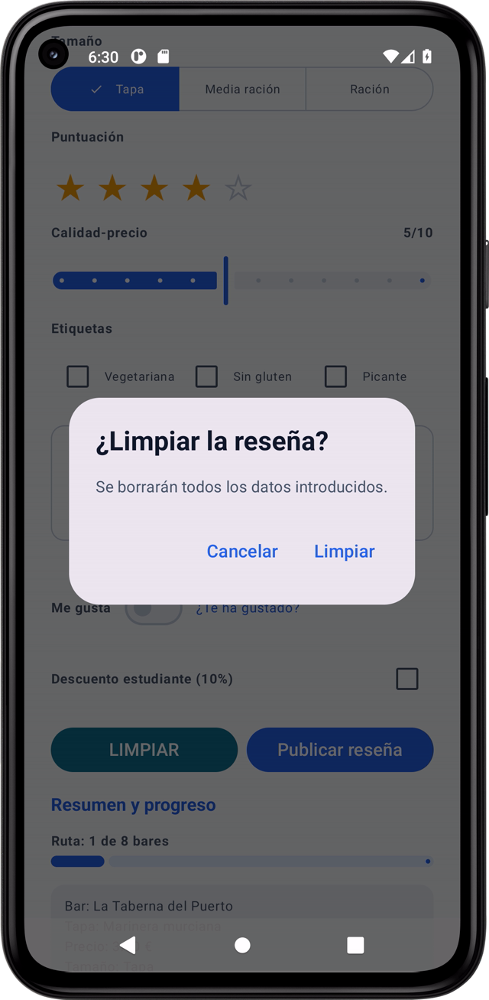 |
| Confirmar Limpiar (toast "Formulario limpio") |  |

## Hallazgo con el Layout Inspector

Usando la inspección de layout (lectura de `bounds` de la jerarquía de UI) se detectó un problema de alineación en el control de **Calidad-precio**:

- El `Slider`/`SeekBar` ocupa desde **x=38** hasta **x=1042**, mientras que el resto del contenido (y su etiqueta "Calidad-precio") respeta el margen **x=66 … x=1014**.
- Es decir, el slider sobresale **~28 px por cada lado** respecto al margen del formulario.

**Causa:** el `Slider` de Material 3 añade un `padding` propio para el área táctil del `thumb`, que hace que sus límites sobrepasen los del contenedor.

