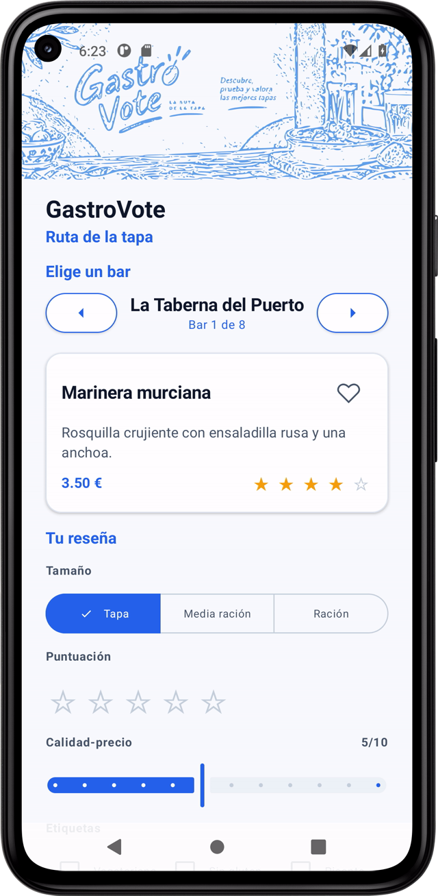
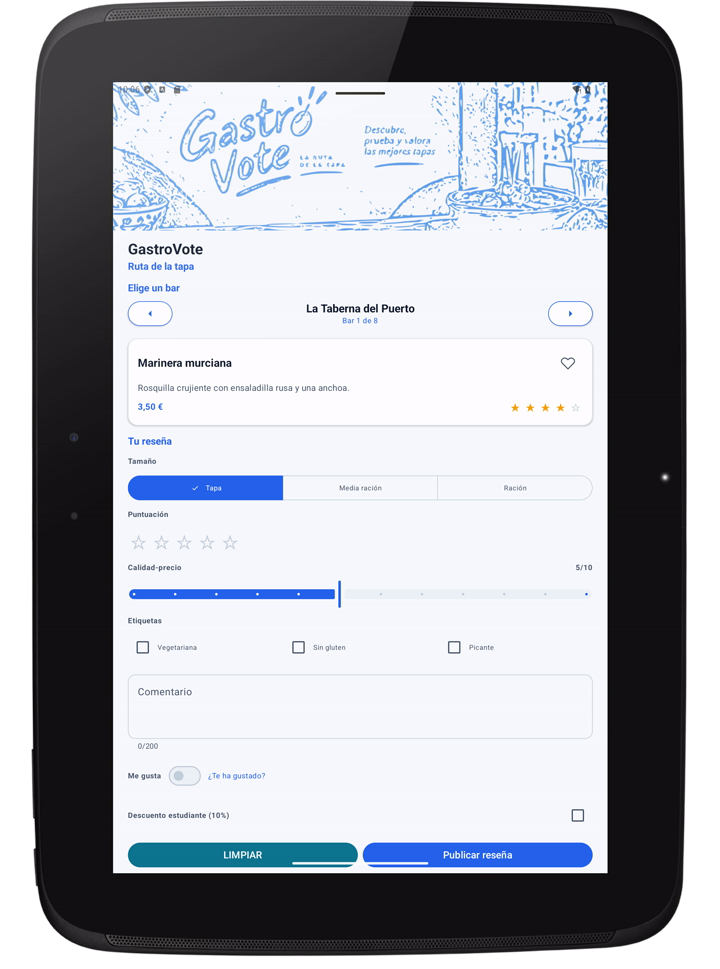
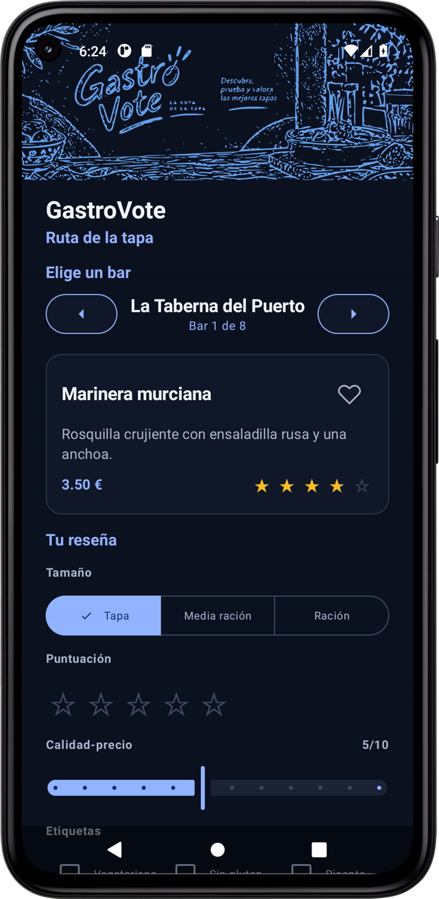
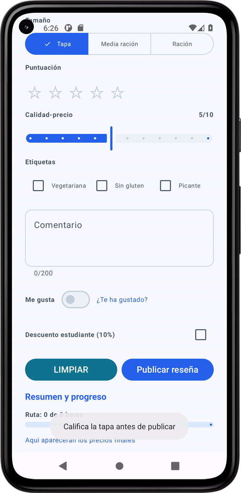
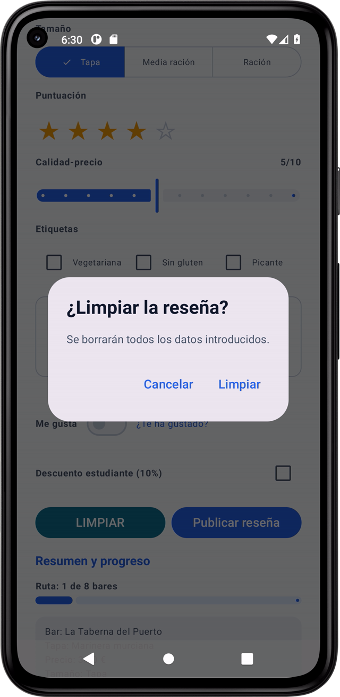
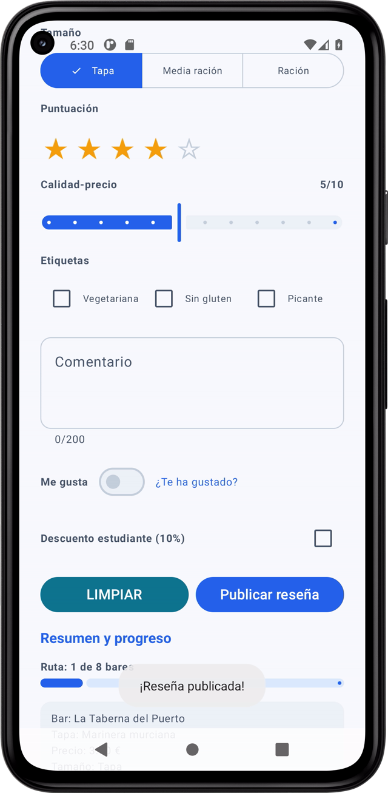

# GastroVote

Android app to rate the tapas of the "Ruta de la tapa": move bar by bar, score each tapa, choose the portion size, apply the student discount and keep a live summary of your route. 

**[ENTREGA1.md](ENTREGA1.md)** (ignore just for academical reasons)

## 📦 Technologies

* Kotlin
* Jetpack Compose
* Gradle (Kotlin DSL)
* JUnit 4

## 🦄 Features

Here's what you can do with GastroVote:

* **Browse the route bar by bar**: previous/next navigation with wrap-around (from the last bar back to the first and vice versa), including the current position and total.

* **Rate each tapa**: 1–5 stars with a text comment, a value-for-money slider, and tags such as *vegetarian*, *gluten-free* or *spicy*.

* **Choose the portion size**: Tapa, Half portion or Full portion, with the price recalculated automatically (×1, ×2 or ×3).

* **Apply the student discount**: a 10% discount with a reminder toast to show the student card.

* **Keep your favourites**: mark a bar as favourite and see it reflected in the tapa card.

* **Publish and review**: publish your review, see a full summary (bar, tapa, size, rating, tags, price, discount, final price…) and clear the form safely with a confirmation dialog.

* **Follow your progress**: a route progress bar shows how many bars you have reviewed.


## 🚦 Running the Project

To run the project in your local environment, follow these steps:

1. Clone the repository to your local machine.

2. Open the project in **Android Studio** (it uses the Gradle wrapper, so no manual Gradle install is needed).

3. Let Gradle sync and build the project:

   ```bash
   ./gradlew assembleDebug
   ```

4. Run the app on an emulator or a physical device (Android 7.0 / API 24 or higher).

5. That's it — pick a bar, rate its tapa and publish your review.

## 🍿 Screenshots

| Small phone (portrait) | Medium tablet (portrait) |
|---|---|
|  |  |

| Light theme | Dark theme | English |
|---|---|---|
|  |  |  |

### Edge cases

| Publish without stars | Clear confirmation | Same bar reviewed twice |
|---|---|---|
|  |  |  |